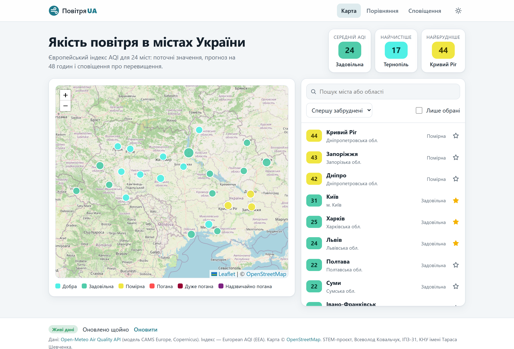

# Повітря UA — моніторинг якості повітря (AQI)

STEM-проєкт: «Адаптивний вебзастосунок для моніторингу та візуалізації якості повітря (AQI) у містах України зі сповіщеннями про перевищення норм. Фронтенд складова».

Автор: Всеволод Ковальчук, ІПЗ-31 (3), ФІТ КНУ імені Тараса Шевченка.

## Можливості

- карта України (Leaflet + OpenStreetMap) з кольоровими маркерами European AQI для 24 міст;
- список міст із пошуком, сортуванням і фільтром «лише обрані»;
- сторінка міста: шкала AQI, рівень, поради для всіх і для чутливих груп, головний забруднювач, картки PM2.5, PM10, NO₂, O₃, SO₂, CO, графік за минулі 24 год і прогноз на 48 год;
- порівняння до трьох міст: графік за обраним показником і таблиця поточних значень;
- обрані міста, власний поріг AQI, банер і системні сповіщення браузера про перевищення;
- світла, темна і системна тема, адаптивна верстка (телефон, планшет, ПК), українська локалізація;
- автономний демо-режим зі змодельованими даними, коли API недоступне.

## Технології

React 19, TypeScript, Vite, React Router (HashRouter), Leaflet / react-leaflet, Recharts, Vitest.
Дані: [Open-Meteo Air Quality API](https://open-meteo.com/en/docs/air-quality-api) (модель CAMS Europe), без ключа.

## Запуск

```bash
npm install
npm run dev        # http://localhost:5173
npm test           # модульні тести
npm run build      # збірка в dist/
npm run preview    # перегляд зібраної версії
```

## Документація

- `docs/uml/` — UML-діаграми (PlantUML: вихідні файли `.puml` і зображення `.png`);
- `docs/screenshots/` — знімки екрана застосунку.



## Структура

```
src/
  data/cities.ts         міста та координати
  lib/aqi.ts             шкала European AQI, рівні забруднювачів, поради
  lib/api.ts             запит до Open-Meteo, розбір відповіді, перехід у демо-режим
  lib/demo.ts            детермінований генератор демо-даних
  lib/storage.ts         localStorage: обрані, налаштування, журнал сповіщень
  lib/format.ts          формат дат і часу (uk-UA, Europe/Kyiv)
  context/AppContext.tsx глобальний стан: дані, обрані, налаштування, сповіщення
  components/            Header, AlertBanner, StatusBar, AqiMap, AqiBadge, Legend, FavButton, HourlyChart
  pages/                 HomePage, CityPage, ComparePage, SettingsPage
  lib/aqi.test.ts        модульні тести
```
